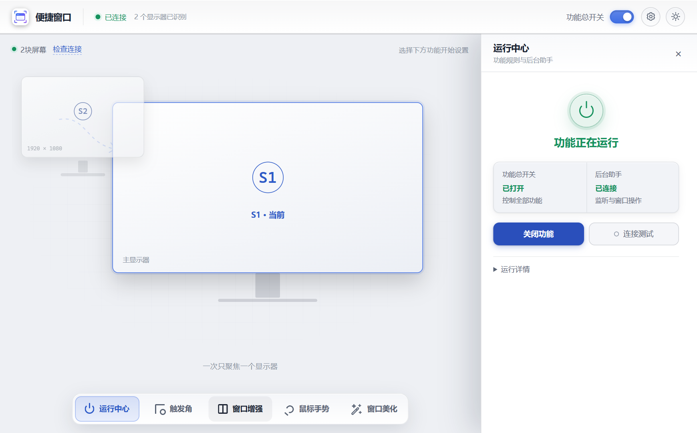
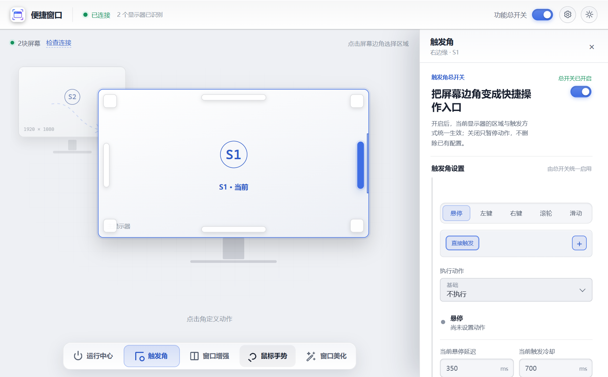
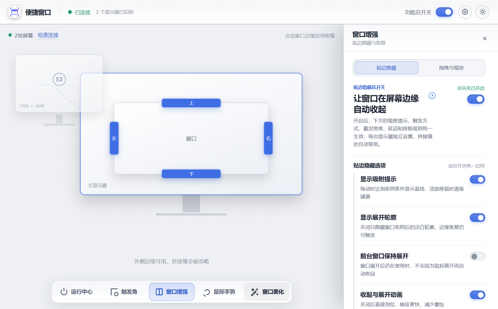
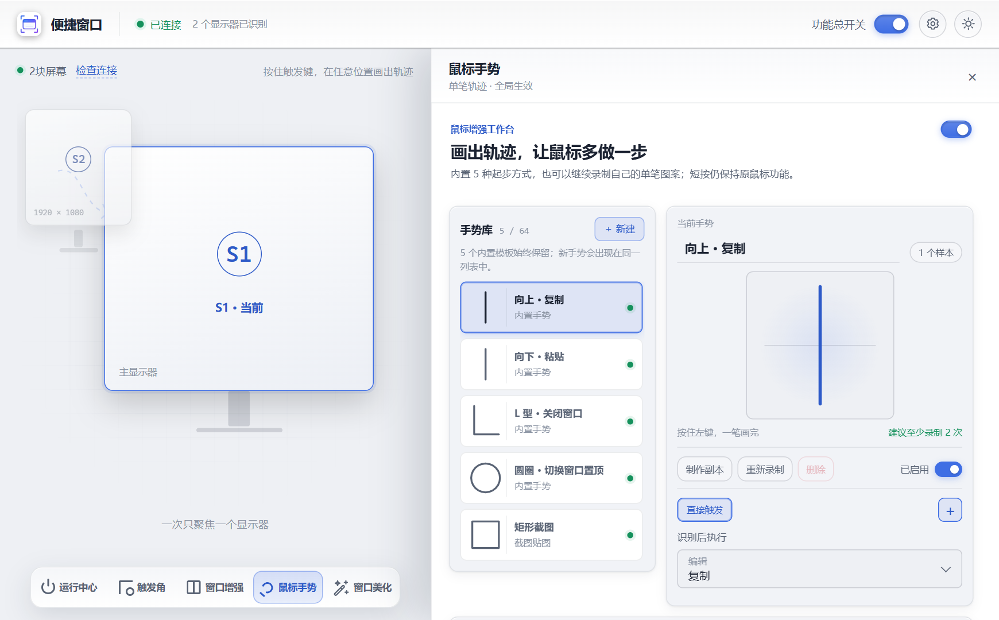

# Convenient Window

[简体中文](README.zh-CN.md) | English

Convenient Window is a desktop utility for hot zones, window control, global mouse gestures, screenshots, and topmost-window control. Version 0.6.6 is the stable Windows x64 release; the previous 0.6.5 stable assets remain available. macOS and Linux X11 platform boundaries remain in the codebase but are not release-verified.

**Turn screen edges and mouse gestures into faster window controls.**

Settings are saved and applied as they change. The standalone app runs from the system tray and packages its native Rust helper with the desktop application.

<p align="center">
  
</p>


## Download

Download the Windows installer or portable archive from the [latest stable release](https://github.com/ximizhou/convenient_window_free/releases/latest). The stable release currently contains Windows assets only; macOS and Linux packages are not published until native acceptance is complete.

- **Installer (`setup.exe`)**: recommended for a normal per-user installation.
- **Portable ZIP**: extract and run without installing.
- **System requirement for the published packages**: Windows 11 x64.

Release assets are currently unsigned. Windows may show an unknown-publisher or Microsoft Defender SmartScreen warning. Checksums and an artifact manifest are included with each release so the downloaded files can be verified.

If security software blocks or quarantines `magic-corners-helper.exe`, the app may report access denied (`os error 5`). Verify the Release checksum first, then inspect the quarantine area or submit a false-positive report; do not treat one heuristic alert as proof of malware or disable protection globally.

The portable archive filename includes its version, but its contents use the stable top-level directory `ConvenientWindow-portable`. Close the app, extract a newer archive over that directory, and replace the files in place. Settings stay in the current user's Local AppData directory rather than inside the portable directory.

## 0.6.5 Stable Release

The Windows x64 [0.6.5 release](https://github.com/ximizhou/convenient_window_free/releases/tag/v0.6.5) was promoted on October 13, 2026 after user acceptance. Its installer, portable archive, manifest and checksums are unchanged from the accepted candidate. Previous stable assets remain available.

## 0.6.6 Stable Release

The Windows x64 [0.6.6 release](https://github.com/ximizhou/convenient_window_free/releases/tag/v0.6.6) was promoted on October 17, 2026 after user acceptance. Its installer, portable archive, manifest and checksums are unchanged from the accepted candidate. The previous 0.6.5 stable downloads remain available.

- Save the current desktop as a window layout: ordinary windows keep their position, size, maximized and topmost state, and can be restored in one click. Minimized windows are restored too; closed, inaccessible or identity-mismatched windows are skipped individually.
- Compose bottom tabs from Settings → Feature entries: drag bubbles between the highlighted row and the spare row, and click a bubble to open that feature. The highlighted row holds up to four features, the Center is always kept, and dropping a fifth entry on a full row shows a red "full" state instead of adding it.
- Bottom tabs and settings bubbles share one icon set, so a feature always uses the same glyph in both places.
- In a narrow layout the bottom tabs keep icons only instead of squeezing the labels; names stay available through hover titles, focus and screen readers.

- Customize hide/restore timing and fix windows failing to tuck away after duration changes or desktop clicks.
- Keep qualified side-edge blue lines visible during paused drags. Near the top, release after the growing line fills to tuck the window away; early release preserves native Snap.
- Reduce redundant anywhere-move/resize updates and provide an adjustable update-rate limit.
- Isolate ordinary shortcuts during native capture, preserve displayed bindings across region changes, and fix corner-click maximize/minimize targets.
- Refresh settings surfaces and spacing, place common choices before numeric tuning, and fix clipped settings after disabling animation or focusing switches.

Animation defaults to 160 ms, with 160/260/400 presets and custom 80–800 ms. The top-edge distance defaults to 48 px and hold duration to 600 ms. The drag-rate limit defaults to 120 Hz, with 60/120/240 presets and custom 30–240 Hz. See [implementation](docs/architecture.md#window-motion-065), [release notes](docs/release-notes/0.6.5.md), and [acceptance scope](docs/testing.md#065-online-acceptance). User acceptance does not certify every UAC, monitor, DPI or host-shortcut environment.

Independent regions may reuse an output combination. Capture cancels on outside interaction, focus loss or teardown; native isolation needs the matching 0.6.5 helper. Secure combinations such as Ctrl+Alt+Delete are unsupported.

Run one host at a time. Keep the desktop interface at ordinary permissions; Settings can elevate only the helper for the current session. The separate login administrator request is off by default, uses explicit UAC, and creates no scheduled task. Protected processes are unsupported. Permission and lifecycle details are in [architecture](docs/architecture.md#optional-administrator-helper-on-windows); inherited 0.6.4 changes are in its [release notes](docs/release-notes/0.6.4.md).

## Features

Development source adds an **Appearance** (slim wand-and-sparkle) entry and moves global settings to a circular top-right gear. Taskbar material is an off-by-default Windows 11 x64 technical prototype with transparent, acrylic and tinted modes plus opacity and border controls. Activation is direct; the Explorer risk note remains inside the panel. The illustrated preview is not proof of actual rendering; initial transparency has received positive local acceptance feedback, while material compatibility, icon clarity, and cross-environment recovery still require per-environment acceptance. The prototype was included in 0.6.3; it remains off by default and does not imply universal compatibility.

- **Zone geometry**: per-display corner width/height with a ratio lock, edge thickness and centered 10–100% length, live preview and per-zone reset. Existing settings keep their original ranges. Schema-v9 settings require the matching helper.
- **Hot zones**: configure the four corners and four edges of each monitor independently, with hover, mouse-button, wheel, and edge-movement triggers. The default-on translucent hover hint can be disabled in Corner parameters without disabling actions or the settings preview.
- **Window edge hiding**: move windows partly off-screen and restore them from a visible edge strip, with multi-window and multi-monitor support. The restore outline and hide/restore animation can be disabled independently without disabling edge restoration.
- **Anywhere move and resize**: move or resize the active window with configurable modifier-and-mouse combinations.
- **Topmost controls**: keep a window above others; a red on-window pin is shown by default and releases the window when clicked.
- **Global mouse gestures**: bind gestures to shortcuts, system actions, commands, and window controls; create and manage custom gesture samples.
- **Window layout snapshots**: enable Window layouts from Settings → Feature entries to save ordinary window positions, sizes, maximized and topmost states, then restore them with one click. Missing or inaccessible windows are skipped individually. The highlighted top row holds up to four bottom entries (the Center is always kept); dragging a fifth entry onto it flashes red and is rejected, while spare entries wait in the dimmed second row. Bottom tabs and bubbles share the same icon set.
- **Screenshots and pinned images**: capture an area, keep the image above other windows, move or resize it, adjust opacity, copy it, or save it as PNG.
- **Local OCR**: recognize text with Windows 11 language capabilities and copy the result without uploading the screenshot.
- **Per-monitor configuration**: preserve independent profiles across supported display layouts and signed virtual-desktop coordinates.
- **Brightness controls**: adjust the triggering display through hot zones and gestures; see [platform requirements](docs/architecture.md#brightness-controls).
- **Live settings**: most changes are persisted and applied immediately, without a separate save step.
- **Light and dark themes**: follow the system appearance by default or remember a manual selection.
- **Chinese and English interface**: the settings window follows your Windows display language by default, and the language can be switched at any time under Settings (gear) → General settings.

## Screenshots

<table>
  <tr>
    <td width="50%"></td>
    <td width="50%"></td>
  </tr>
  <tr>
    <td align="center"><strong>Hot zones</strong></td>
    <td align="center"><strong>Window enhancement</strong></td>
  </tr>
  <tr>
    <td colspan="2"></td>
  </tr>
  <tr>
    <td colspan="2" align="center"><strong>Mouse gestures, screenshots, and local OCR</strong></td>
  </tr>
</table>

### How edge hiding works

1. Drag a window toward a screen edge.
2. Release it to tuck the window away.
3. Move the pointer back to the visible edge strip to restore it.

## Quick Start

1. Download the installer or portable ZIP from the [latest release](https://github.com/ximizhou/convenient_window_free/releases/latest).
2. Install the app, or extract the portable archive into its `ConvenientWindow-portable` directory and run `ConvenientWindow.exe`; replace that same directory's files when upgrading.
3. Open Convenient Window from the system tray.
4. Turn on the main feature switch, then configure hot zones, window enhancements, or mouse gestures.

Closing the settings window keeps the tray application running. Use the tray menu to reopen settings, control startup behavior, or quit the application.

## Privacy and Security

- OCR is performed through local Windows APIs. Screenshots are not uploaded for recognition.
- Configuration, authentication tokens, usage data, and logs stay in the application's local data directory. Removing the portable program directory does not remove those settings by design.
- Local WebSocket access is protected by a random token.
- A platform-native single-instance lock prevents separate host integrations from controlling competing helper processes.

See [SECURITY.md](SECURITY.md) to report a vulnerability privately.

## Current Limitations

- Windows 11 x64 is the release-accepted platform and retains the complete feature set.
- macOS (x64 and arm64) has a native helper boundary for global input, accessibility window control, monitor discovery, and screen capture. Accessibility and Screen Recording permissions are required. OCR, edge hiding, and arbitrary-window topmost are explicitly unavailable.
- Linux x64 under X11 has native helper support for global input, window control, monitor discovery, screen capture, and EWMH topmost. OCR and edge hiding are explicitly unavailable.
- Volume uses Windows/macOS Core Audio and `pactl` on Linux, including PipeWire with its PulseAudio service. Volume and brightness share a passive desktop indicator with device readback, mute state, and errors. See [adjustment feedback](docs/architecture.md#adjustment-feedback). The Windows path is release-accepted; the macOS and Linux audio backends and the indicator placement there are implemented but not yet verified on real hardware.
- The standalone app includes the passive indicator. Host integrations can render the same feedback and retain status text when their overlay is unavailable.
- Linux Wayland is detected and reports unavailable capabilities; the helper does not pretend to provide global input or arbitrary-window control there.
- macOS and Linux release assets remain unverified until native runner and real-machine smoke evidence is recorded.
- The installer and executable are not currently code-signed.
- Automatic application updates are not implemented.

## For Developers

This repository is the source of truth for:

- `apps/desktop/`: the Tauri 2 desktop host and reusable Svelte interface.
- `helper/`: the shared Rust helper used by the standalone desktop app and supported host integrations.
- `scripts/`: reproducible build, packaging, smoke-test, and artifact-audit entry points.

Host integrations consume this repository as a submodule and supply their own host adapters. They do not maintain a second copy of the helper source.

### Prerequisites

Building the Windows x64 helper now also requires Visual Studio C++ Build Tools and a Windows SDK with C++/WinRT headers. The native taskbar build reuses `scripts/windows-toolchain.ps1`; if discovery cannot find an existing installation, set `VSINSTALLDIR` to that installation directory. No additional runtime download is performed for the taskbar component.

- Node.js `24.14.0` as pinned by `.node-version`
- Windows 11 x64 for the release installer, portable archive, and full Windows behavior
- macOS 13+ (x64 or arm64) for native helper checks; grant Accessibility and Screen Recording permissions when running the helper interactively
- Ubuntu 22.04+ with an X11 display (CI uses Xvfb) for Linux helper checks; Wayland sessions are detection/degradation tests only
- Rust `1.96.0` or a newer stable toolchain for native macOS/Linux checks. The repository `rust-toolchain` pins the Windows GNU target, so native runners must invoke `cargo +stable` explicitly.

Install dependencies and run the frontend checks:

```powershell
npm ci
npm run desktop:test
npm run desktop:check
npm run desktop:frontend
```

Build the Svelte frontend, Rust helper sidecar, Tauri application, per-user NSIS installer, and portable archive:

```powershell
npm run desktop:build
```

Use `scripts/build-desktop.ps1 -ArtifactsDir artifacts/<candidate>` to preserve existing outputs. The path must stay inside this repository's `artifacts/` directory. Use explicit paths for the matching audit/runtime/install gates in [Testing](docs/testing.md#local-gates); the default npm smoke commands below target root `artifacts/`. A path alone is not build evidence.

Run the packaged lifecycle and artifact checks:

Installer automation requires an isolated account/CI with no existing product installation. Preserve existing user installations during local preparation; give the setup to the user for actual installation/upgrade acceptance.

```powershell
npm run desktop:runtime-smoke
npm run desktop:runtime-conflict-smoke
npm run desktop:runtime-force-kill-smoke
npm run desktop:install-smoke
npm run desktop:audit
npm run desktop:source-audit
```

For helper-only Windows development, run commands from `helper/` so its linker configuration is applied:

```powershell
rustup toolchain install 1.96.0-x86_64-pc-windows-gnullvm --profile minimal --component rustfmt
cd helper
rustup run 1.96.0-x86_64-pc-windows-gnullvm cargo fmt --check
rustup run 1.96.0-x86_64-pc-windows-gnullvm cargo test
```

The Windows build generates `THIRD-PARTY-NOTICES.txt` from the installed npm production tree and locked Cargo dependency graphs. The installer and portable package must contain both that file and the project license; missing or unauditable license text stops the build.

Native macOS checks:

```bash
npm ci --prefix apps/desktop
npm --prefix apps/desktop run check
npm --prefix apps/desktop test
npm --prefix apps/desktop run build
cargo +stable fmt --manifest-path helper/Cargo.toml --check
cargo +stable test --manifest-path helper/Cargo.toml --target x86_64-apple-darwin
cargo +stable check --manifest-path apps/desktop/src-tauri/Cargo.toml --target x86_64-apple-darwin
```

Native Linux X11 checks (the display must be available; CI starts Xvfb):

```bash
sudo apt-get install -y pkg-config libx11-dev libxtst-dev libxi-dev libxinerama-dev libxrandr-dev libxss-dev libwayland-dev libgtk-3-dev libwebkit2gtk-4.1-dev libayatana-appindicator3-dev librsvg2-dev xvfb
Xvfb :99 -screen 0 1920x1080x24 -noreset &
export DISPLAY=:99
export XDG_SESSION_TYPE=x11
npm ci --prefix apps/desktop
npm --prefix apps/desktop run check
npm --prefix apps/desktop test
npm --prefix apps/desktop run build
cargo +stable fmt --manifest-path helper/Cargo.toml --check
cargo +stable test --manifest-path helper/Cargo.toml --target x86_64-unknown-linux-gnu
cargo +stable check --manifest-path apps/desktop/src-tauri/Cargo.toml --target x86_64-unknown-linux-gnu
```

More technical information:

- [Architecture](docs/architecture.md)
- [Testing](docs/testing.md)
- [Release process](docs/release.md)
- [Security policy](SECURITY.md)

## Release Integrity

Public builds use a two-stage acceptance process: a clean `main` build is published as a replaceable Pre-release candidate, whose same-version assets may be refreshed while testing continues; after acceptance, the exact assets are promoted to stable without replacement. Every release includes SHA-256 checksums and an artifact manifest tied to the source commit. Stable assets are immutable; replacing a stable binary requires a new patch version and tag.

## License

This project is source-available under the [PolyForm Noncommercial License 1.0.0](LICENSE).

You may view, study, modify, and use the software for personal and other noncommercial purposes under the license terms. Commercial use requires a separate written license from the copyright holder.

This license applies to the repository from the commit that introduced it onward. Earlier versions already published under the MIT License remain available under the license granted with those versions.
